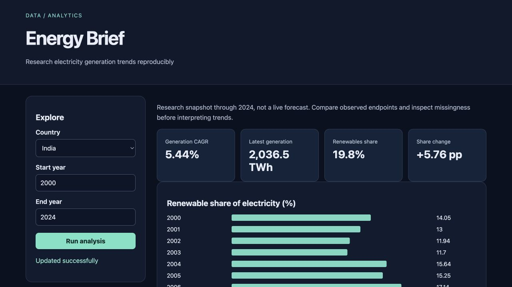

# Energy Brief

Research electricity generation trends reproducibly for **industry researchers**.

Original topic: **Data-Driven Industry Report** from [the source post](https://www.instagram.com/p/DdyMaogE4ud/).

> Personal project by Abhijith Viswanathan. Working implementation, reproducible examples and measured results are documented below.



## What works

- Pinned public data
- trend decomposition
- concentration
- report

[Example output](reports/example-output.json) · [Recorded checks](reports/test-results.txt) · [Learning and interview guide](LEARNING_GUIDE.md)

## Start

Python 3.12 is the validated Python runtime. Run commands from this repository directory. Windows users activate `.venv\Scripts\activate` instead of `source`.

```sh
python3.12 -m venv .venv
source .venv/bin/activate
python -m pip install -r requirements.txt
python app.py
```

Open **http://127.0.0.1:8080**. Keep the process running. Set `PORT` to use another port. The Python development servers are intended for local demonstrations.

## Demonstration

Compare a country's electricity generation and renewable share over time, change the period, and inspect observed endpoints plus missingness. Regenerate the report and verify the source checksum.

## Architecture and decisions

Browser controls → validated Flask API → project analysis/workflow → results and export.

Stack: Python · pandas · Flask.

1. Pin the public dataset commit and hash both source and extracted subset.
2. Retain missing observations and report the actual endpoints used instead of interpolating silently.
3. Keep electricity-generation units and renewable-share changes distinct from total energy or causal policy effects.

## Verification

```sh
python -m pytest -q
```

See [VERIFICATION.md](VERIFICATION.md) for actual executed checks, setup verification, model/data results and any outstanding environment limitations. The [recorded CI runs](reports/ci-verification.json) passed for the linked source revision.

## Data and attribution

Our World in Data energy data / cited upstream. See [DATA_AND_SOURCES.md](DATA_AND_SOURCES.md) for provenance and usage notes. Original project code is MIT unless a preserved source file or dependency states otherwise. Model and third-party data licenses remain separate.

## Limitations and next improvement

Six selected countries and years 2000–2024. Source revisions, missingness and country coverage affect comparisons. Descriptive research, not an investment forecast or causal estimate. Upstream data attribution and terms remain applicable.

Suggested extension: Add a seventh country through the pinned acquisition script and document selection bias.

## Honest portfolio use

AI tools assisted with implementation, tests and documentation. This is my personal portfolio work; benchmark results and deployment boundaries are documented in the repository.

## Connect

[LinkedIn — Abhijith Viswanathan](https://www.linkedin.com/in/abhijith-viswanathan-0a7216436/)
